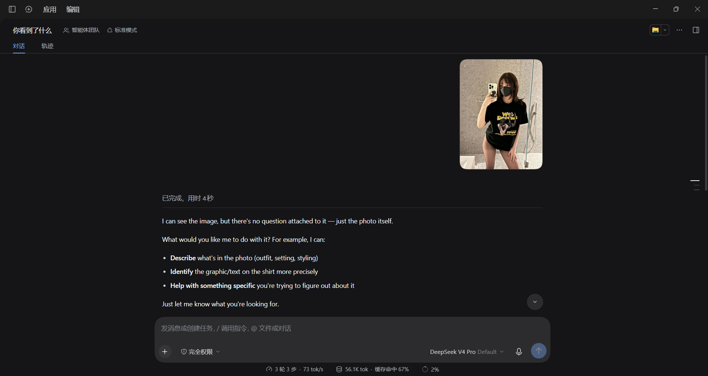
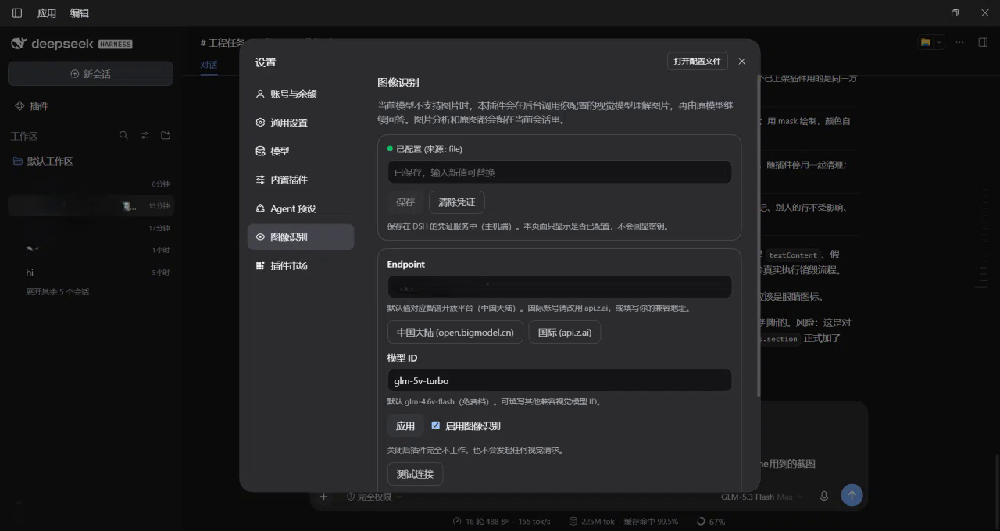

# dsh-vision-better

English | [中文](README.zh-CN.md)

Give a **text-only model** in DeepSeek Harness the ability to work with images - without switching the
model, starting a new session, or changing a single visible message.

Paste an image into the chat as usual. If the active model cannot accept images, this plugin sends the
image to **your own** GLM-compatible vision endpoint, and hands the analysis to the *original* model as
hidden context. The original model keeps answering, in the same session, with its history intact.

- No new chat buttons, modes, model entries, assistant bubbles, or extra messages.
- No vision request at all when there is no image, or when the active model already accepts images.
- The API key is stored by DSH's credential service on the host and is never sent back to the browser.
- The image, your text, the session id, and the selected provider/model are never touched.

---

## Requirements

| | |
|---|---|
| DeepSeek Harness | **0.2.0-rc.2** or newer within `0.2.x` |
| Node.js | >= 22.19 (the runtime DSH ships is fine) |
| Core extension | **required for image admission** - see [Core extension](#core-extension-required) |
| Provider account | A Zhipu (智谱) open-platform API key, or any GLM-compatible vision endpoint |

The plugin itself has **zero dependencies** and no build step. Its settings page is hand-written and uses
only the platform's own React.

### Core extension (required)

Stock DSH rejects a prompt that carries an image *before* the message is stored, whenever the active model
does not declare image support
(`@deepseek-ai/dsh-api-session-controller/lib/index.js:870-874`). No public plugin hook can influence that
check, and pretending the model supports images is deliberately out of bounds.

This repository therefore ships one small, separate core patch that adds a single public waterfall -
`session/image-admission` - around that check:

```
patches/0001-session-image-admission.patch
```

- Default behaviour is unchanged when no plugin answers (verified: see [Testing](#testing)).
- The plugin answers `{ admit: true }` only when the relay is enabled **and** an API key is configured.
- From a source checkout: `git apply -p1 patches/0001-session-image-admission.patch`
- On an installed desktop app (no source tree): run `patches/apply-core-patch.cmd`, then close DeepSeek
  Harness so it can swap the archive, then start it again. `patches/restore-core-patch.cmd` puts the original
  back. Both stage and verify before touching anything.
- Verify without applying anything: `node patches/verify-patch.mjs <dsh-src-root>`

Until this extension ships upstream, the hidden-vision-context half still works on a stock install (nothing
breaks) but images never reach a text-only session. **Minimum DSH version for the full experience: 0.2.0-rc.2
+ this patch**, or the first release that provides `session/image-admission`.

---

## Install

Install from GitHub (recommended), or from a local clone:

```bash
# from GitHub
dsh plugin --profile web add github:ethanweave/dsh-vision-better

# or from a released tarball
dsh plugin --profile web add https://github.com/ethanweave/dsh-vision-better/releases/latest/download/dsh-vision-better-1.0.0.tgz

# or from a local clone (an absolute path is accepted by the plugin manager)
dsh plugin --profile web add /absolute/path/to/dsh-vision-better
```

The same operations are available in the Web UI on the **Plugins** page, which accepts a path or a spec.
**Restart DSH** afterwards the first time, so the new bundle and its settings page are registered.

Then open **Settings -> 图像识别 / Vision Better**.

> **Important — image admission needs a small core patch.** Stock DSH rejects an image before it reaches a
> text-only model (see [Core extension](#core-extension-required)). Without it the settings page and the API
> key work, but image turns are refused. Apply it with `patches/apply-core-patch.cmd` (double-click, then
> close DeepSeek Harness so it can swap the archive) and restart again.

## Screenshots

**Settings → 图像识别 (Vision Better)** — API key status, endpoint presets, model id, enable toggle and a
connection test that never touches your conversation images:



**The same session, the same model** — an attached image is analyzed in the background and the original
model answers from that analysis; your message and the image stay untouched:




---

## Configure

| Field | Default | Notes |
|---|---|---|
| API key | *(empty)* | Stored in DSH's credential store on the host (`~/.dsh/.credentials.yaml`, reference `GLM_API_KEY`). The page only ever shows *configured / not configured*. |
| Endpoint | `https://open.bigmodel.cn/api/paas/v4` | Mainland China (智谱开放平台). Use `https://api.z.ai/api/paas/v4` for an international account, or your own compatible base URL. `/chat/completions` is appended. |
| Model ID | `glm-4.6v-flash` | Free tier at the time of writing; any compatible vision model id works. |
| Enable | on | Turning it off makes the plugin inert; it makes no request and does not touch admission. |
| Test connection | - | Sends a **built-in 16x16 sample image**, never anything from your conversation. |

Defaults were verified against the official Zhipu documentation on **2026-10-10**:
[mainland base URL](https://docs.bigmodel.cn/cn/guide/develop/http/introduction),
[international base URL](https://docs.z.ai/api-reference/introduction),
[`glm-4.6v-flash`](https://docs.bigmodel.cn/cn/guide/models/free/glm-4.6v-flash) (listed as 完全免费 / completely free).

> Free quota and rate limits are set by the provider and can change. This plugin does **not** promise that
> free access is permanent or unlimited, and it does not ship invented size or pixel limits: the provider's
> own error is the authority.

You can also export `GLM_API_KEY` in the environment DSH launches with; the credential store gives the
environment precedence, and the settings page will report the key as configured (read-only).

---

## How it works

```
you paste an image -> DSH session/prompt
                |- model declares image support -> native image request (sidecar silent, 0 calls)
                `- model is text-only -> core patch asks session/image-admission
                        `- plugin: enabled and key configured -> admit
                               `- agent/pre-step: read this turn's authorized attachments
                                     `- one batched vision request (GLM)
                                           `- hidden context message (source.kind = "vision-better")
                                                  `- the original model answers: same session, same model, same history
```

The hidden context is a normal durable `user/message` whose source kind is not `"user"`. DSH's own client
classifies exactly that shape as a **context node**, which is excluded from the visible transcript
(`dsh-client-ui-chat` -> `isVisibleChatNode`). The same mechanism DSH already uses for its runtime-context
snapshot. The user's own message - including the image - is never rewritten, and it survives restore.

### Routing

| Active model capability | Images in the turn | Vision requests |
|---|---:|---:|
| Declares image support | any | **0** |
| Declares text only | none | **0** |
| Declares text only | >= 1 | **1 per turn** (all images batched) |
| Not declared (`undefined`) | >= 1 | **1 per turn** - unknown is never treated as support |

Capability is read from the session's live selection (the projection DSH publishes to its model picker) on
every step, so a model switch takes effect on the very next turn; nothing is cached across turns.

### Failure behaviour

The plugin never throws inside the turn - a throw at that point would drop the user's message before DSH
logs it. Instead it injects an explicit, hidden notice with a stable code, and the original model tells you
what went wrong while your text and image stay in the conversation:

| Code | Meaning |
|---|---|
| `VISION_RELAY_UNCONFIGURED` | No API key saved (no network request was made) |
| `VISION_RELAY_UNAUTHORIZED` | Endpoint rejected the key (401/403) |
| `VISION_RELAY_MODEL_NOT_FOUND` | Wrong endpoint path or model id (404) |
| `VISION_RELAY_RATE_LIMITED` | 429; retried within the bounded budget, honouring `Retry-After` |
| `VISION_RELAY_UPSTREAM_ERROR` | 5xx; retried with bounded exponential backoff |
| `VISION_RELAY_TIMEOUT` / `_NETWORK` | Deadline or transport failure |
| `VISION_RELAY_BAD_REQUEST` / `_BAD_RESPONSE` | The request or the reply was rejected/unusable |
| `VISION_RELAY_IMAGE_TOO_LARGE` / `_UNSUPPORTED` | Local pre-flight validation failed (includes the request-body cap) |
| `VISION_RELAY_ABORTED` | You stopped the turn; the vision request was cancelled with it |

Invalid keys, wrong model ids and invalid images are **never** retried. Every request uses
`redirect: "error"`, so a credential can never be replayed to another origin.

---

## Privacy and security

- Images are sent **only** to the vision endpoint you configured, and only when the active model cannot
  accept images and the turn really carries one. Nothing is sent to DeepSeek's chat service or to any other
  provider.
- The API key lives in DSH's credential store. Only the host half reads it, per request, without caching.
  The browser can write and clear it and can read *whether* it is configured - never its value.
- Logs contain a code, a duration, and a redacted endpoint label. Never a key, an image, base64, or a full
  prompt.
- Images are read through DSH's attachment service using the references carried by your own message. The
  plugin accepts no path, URL, or id from the browser, so it cannot be used to read arbitrary files or
  another session's attachments.
- Image content and any text inside an image are treated as untrusted data: the analysis is fenced with a
  **per-message random nonce** that the vision endpoint cannot know when it answers, so it cannot forge the
  terminator and continue as if it were plugin instructions. Control characters are stripped.
- The analysis cache is in-memory only, bounded (64 entries, 30 minutes), keyed by image hash + endpoint +
  model + analysis version + question, and stores text only. No image is written anywhere new, and the
  plugin never re-uploads your image a second time.
- The settings-page routes are same-origin checked (a `null` origin and cross-origin requests are refused),
  JSON-only, size-capped, and validate the key's character set. They never return a secret.

See [SECURITY.md](SECURITY.md) for reporting a vulnerability.

---

## Troubleshooting

| Symptom | What to do |
|---|---|
| Image is refused with *"does not support image input"* | The core extension is not applied, or the relay is disabled/unconfigured. Apply `patches/0001-session-image-admission.patch` and check Settings -> 图像识别. |
| `VISION_RELAY_UNCONFIGURED` | Save an API key in Settings -> 图像识别. No request is made until you do. |
| `VISION_RELAY_UNAUTHORIZED` | Re-check the key, and that the endpoint matches the account's region (mainland vs `api.z.ai`). |
| `VISION_RELAY_MODEL_NOT_FOUND` | Check the model id and that the endpoint is a base URL ending in the API version (e.g. `/api/paas/v4`). |
| `VISION_RELAY_BAD_REQUEST` | The endpoint may not accept the image encoding used. Try another compatible endpoint or model; the plugin already retried the alternative base64 encoding once. |
| `VISION_RELAY_IMAGE_TOO_LARGE` | The image or the whole request is above this plugin's local cap (5 MiB per image, 24 MiB per request). |
| No `Settings -> 图像识别` entry | Restart DSH after installing; confirm the bundle is enabled on the Plugins page. |
| Nothing happens at all on a stock install | Expected: image admission needs the core extension. The plugin is inert until it can be asked. |

## Disable or uninstall

- **Disable:** Settings -> Plugins, turn the bundle off (or set `disabled: true` for the `vision-better` row in
  the profile's `cordis.patch.yml`). DSH's original text and multimodal behaviour returns immediately.
- **Uninstall:** `dsh plugin --profile web remove dsh-vision-better`, or remove it on the Plugins page.
- **Remove your key:** Settings -> 图像识别 -> *Clear credential* (this unsets the `GLM_API_KEY` reference).
- **Remove local state:** `<DSH_HOME>/vision-better.json` holds only endpoint/model/enabled.

---

## Testing

```bash
node scripts/check.mjs --dsh-src <path-to-dsh-source>   # everything that can run here
node scripts/verify-host-path.mjs                        # end-to-end on a simulated DSH host (43 checks)
node scripts/verify-client-bundle.mjs                    # browser-half contract + render smoke test (24 checks)
node patches/verify-patch.mjs <path-to-dsh-source>        # core patch applies + behaves (8 checks)
node test/run.mjs                                        # unit/integration suite (129 tests, mocked vision API)
```

All automated tests use a stubbed or loopback vision API. A real API key is never required, read, or
printed; real-endpoint tests are opt-in only.

## Repository layout

```
lib/            host half: routing, config, image access, GLM client, cache, relay, settings routes
client/         browser half: the hand-written Settings page bundle
patches/        the separate core extension (patch + generator + verifier)
scripts/        local verification (syntax gate, end-to-end host path, browser-half smoke test)
test/           unit/integration suite
awesome/        ready-to-submit entry for the awesome-dsh-plugin list
docs/           implementation plan and publishing checklist
```

## License

[MIT](LICENSE)
