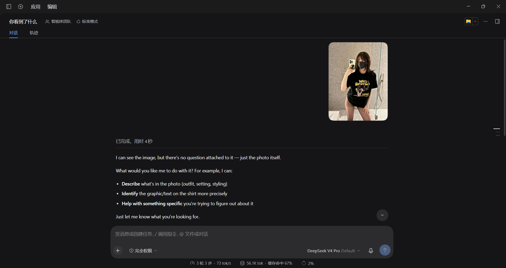
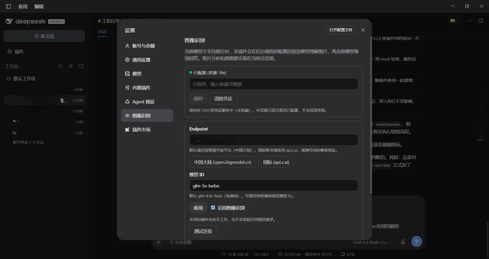

# dsh-vision-better（DSH 图像识别）

[English](README.md) | 中文

让 DeepSeek Harness 里**只支持文本的模型**也能处理图片——不切换模型、不新建会话、不改动任何一条可见消息。

像平常一样把图片粘贴进聊天。如果当前模型不能接收图片，本插件会把图片发送到**你自己配置的** GLM 兼容视觉接口，
并把分析结果作为隐藏上下文交给**原模型**。原模型在同一会话、同一历史里继续回答。

- 不新增聊天按钮、模式、模型选项、助手气泡或额外消息。
- 没有图片时不发起任何视觉请求；当前模型原生支持图片时同样一次都不发。
- API Key 由 DSH 主机端凭证服务保存，浏览器永远拿不到明文。
- 原图、你的原始文字、Session ID、当前 provider/model 全程不变。

---

## 环境要求

| | |
|---|---|
| DeepSeek Harness | **0.2.0-rc.2** 及以上（`0.2.x` 范围内） |
| Node.js | ≥ 22.19（DSH 自带运行时即可） |
| 核心扩展 | **图片准入必需**，见下文 |
| 服务账号 | 智谱开放平台 API Key，或任意 GLM 兼容视觉接口 |

插件本身**零依赖、无需构建**，设置页为手写、仅使用平台自带的 React。

### 核心扩展（必需）

未经修改的 DSH 会在消息**入库之前**就拒绝带图片的请求：只要当前模型没有声明支持图片
（`@deepseek-ai/dsh-api-session-controller/lib/index.js:870-874`）。这个判断没有任何公开插件扩展点，
而伪造模型能力是明确禁止的。

因此本仓库单独提供一个小补丁，只在该判断外面加一个公开 waterfall `session/image-admission`：

```
patches/0001-session-image-admission.patch
```

- 没有插件响应时行为与现状完全一致（已实测验证）。
- 只有在插件**已启用且已配置 Key** 时才返回 `{ admit: true }`。
- 源码树：在包根目录执行 `git apply -p1 patches/0001-session-image-admission.patch`
- 已安装的桌面版（无源码树）：运行 `patches/apply-core-patch.cmd`，随后**完全关闭 DeepSeek Harness**
  让它完成替换，再启动。`patches/restore-core-patch.cmd` 可还原原始文件；两者都会先构建并校验、再替换。
- 不修改任何文件即可验证：`node patches/verify-patch.mjs <dsh-source-root>`

在上游合并该扩展之前，未打补丁的安装上「隐藏视觉上下文」部分仍然可用（不会破坏任何东西），
但图片无法进入纯文本会话。**完整体验的最低 DSH 版本：0.2.0-rc.2 + 本补丁**，或首个提供
`session/image-admission` 的正式版本。

---

## 安装

推荐直接从 GitHub 安装，也可以用本地克隆：

```bash
# 从 GitHub 安装
dsh plugin --profile web add github:ethanweave/dsh-vision-better

# 或使用发布包
dsh plugin --profile web add https://github.com/ethanweave/dsh-vision-better/releases/latest/download/dsh-vision-better-1.0.0.tgz

# 或从本地克隆（插件管理器接受绝对路径）
dsh plugin --profile web add /absolute/path/to/dsh-vision-better
```

也可以在 Web 界面 **Plugins** 页面同样操作。首次安装后请**重启 DSH**，让新 bundle 与设置页生效。

然后打开 **设置 → 图像识别**。

> **重要 —— 图片准入需要一个小的核心补丁。** 原版 DSH 会在图片进入纯文本模型前就拒绝它
> （见上文「核心扩展（必需）」）。不打补丁时，设置页与 Key 功能正常，但带图消息会被拒。
> 运行 `patches/apply-core-patch.cmd`（双击后按提示完全关闭 DeepSeek Harness 让它完成替换），
> 然后再重启一次。

## 截图

| 设置 → 图像识别 | 纯文本模型根据附图作答 |
|---|---|
|  |  |

---

## 配置

| 字段 | 默认值 | 说明 |
|---|---|---|
| API Key | 空 | 保存在主机端 DSH 凭证服务（`~/.dsh/.credentials.yaml`，引用名 `GLM_API_KEY`）。页面只显示是否已配置。 |
| Endpoint | `https://open.bigmodel.cn/api/paas/v4` | 中国大陆（智谱开放平台）。国际账号填 `https://api.z.ai/api/paas/v4`，也可填自己的兼容地址；插件会拼接 `/chat/completions`。 |
| 模型 ID | `glm-4.6v-flash` | 当前为免费档；可填任意兼容视觉模型 ID。 |
| 启用 | 开 | 关闭后插件完全不工作，也不会影响图片准入。 |
| 测试连接 | — | 使用**内置的 16×16 小图**，绝不使用你会话里的任何图片。 |

默认值已于 **2026-10-10** 按官方文档核实：
[大陆 Base URL](https://docs.bigmodel.cn/cn/guide/develop/http/introduction)、
[国际 Base URL](https://docs.z.ai/api-reference/introduction)、
[`glm-4.6v-flash`](https://docs.bigmodel.cn/cn/guide/models/free/glm-4.6v-flash)（标注「完全免费」）。

> 免费额度与速率限制由服务方决定且可能变化。本插件**不承诺**额度永久或无限，也不会写入未经核实的
> 尺寸/像素上限——以服务方返回的错误为准。

也可以在 DSH 的启动环境里导出 `GLM_API_KEY`：凭证服务以环境变量优先，页面会显示为已配置（只读）。

---

## 工作原理

```
用户粘贴图片 → DSH session/prompt
                ├─ 模型声明支持图片 → 原生图文请求（侧车完全静默，0 次调用）
                └─ 模型只支持文本 → 核心补丁询问 session/image-admission
                        └─ 插件：已启用且已配置 Key → 放行
                               └─ agent/pre-step：读取本轮授权附件
                                     └─ 一次批量视觉请求（GLM）
                                           └─ 隐藏上下文消息（source.kind = "vision-better"）
                                                  └─ 原模型继续回答：同一会话、同一模型、同一历史
```

隐藏上下文就是一条普通的持久化 `user/message`，只是 `source.kind` 不是 `"user"`。DSH 客户端正是按这个
特征把它归类为 **context 节点**并排除在可见会话流之外（`dsh-client-ui-chat` 的 `isVisibleChatNode`），
与 DSH 自己注入运行时上下文的机制完全相同。用户自己的消息（含图片）从未被改写，恢复后依然完整。

### 路由

| 当前模型能力 | 本轮有图片 | 视觉请求 |
|---|---:|---:|
| 声明支持图片 | 任意 | **0** |
| 明确只支持文本 | 否 | **0** |
| 明确只支持文本 | 有 | **每轮 1 次**（多图合并请求） |
| 未声明（`undefined`） | 有 | **每轮 1 次**——未知绝不当作支持 |

能力值每一步都从当前会话的**实时选择**读取（DSH 公布给模型选择器的那份投影视图），因此在用户刚切换
模型的下一轮就立刻生效，不存在跨轮缓存。

### 失败行为

插件在轮内**从不抛异常**——在那个位置抛异常会让用户消息在 DSH 写日志前丢失。它改为注入一条明确的隐藏提示
（带稳定错误码），由原模型如实告知你，同时你的文字和图片仍留在会话中：

| 错误码 | 含义 |
|---|---|
| `VISION_RELAY_UNCONFIGURED` | 未保存 API Key（未发起任何网络请求） |
| `VISION_RELAY_UNAUTHORIZED` | 接口拒绝该 Key（401/403） |
| `VISION_RELAY_MODEL_NOT_FOUND` | Endpoint 路径或模型 ID 错误（404） |
| `VISION_RELAY_RATE_LIMITED` | 429，在有界预算内重试并遵守 `Retry-After` |
| `VISION_RELAY_UPSTREAM_ERROR` | 5xx，有界指数退避重试 |
| `VISION_RELAY_TIMEOUT` / `_NETWORK` | 超时或传输失败 |
| `VISION_RELAY_BAD_REQUEST` / `_BAD_RESPONSE` | 请求被拒或响应不可用 |
| `VISION_RELAY_IMAGE_TOO_LARGE` / `_UNSUPPORTED` | 本地预检未通过（含请求体上限） |
| `VISION_RELAY_ABORTED` | 你点了停止；视觉请求随之取消 |

无效 Key、错误模型、无效图片**绝不重试**。所有请求都使用 `redirect: "error"`，凭证不可能被重定向带到其他域名。

---

## 隐私与安全

- 图片**只**发送给你配置的视觉接口，且仅在当前模型不能收图、且本轮确实带图时才发送；不会发给 DeepSeek
  聊天服务或任何未配置的服务。
- API Key 存在 DSH 凭证服务里，只有主机端按请求读取、不缓存；浏览器可以写入/清除，也只能读到「是否已配置」。
- 日志只含错误码、耗时和脱敏后的 Endpoint；不含 Key、图片、base64 或完整提示词。
- 图片只通过 DSH 附件服务读取你消息里携带的引用；插件不接受来自浏览器的路径、URL 或 ID，因此无法被用来
  读取任意文件或其他会话的附件。
- 图片内容与图中文字一律视为不可信数据：分析文本用**每条消息随机生成的 nonce** 围栏包裹，视觉接口在生成
  回答时无法预知该 nonce，因此无法伪造结束标记、把自己伪装成插件指令；控制字符会被清理。
- 分析缓存仅在内存中、有上限（64 条 / 30 分钟），键包含图片哈希 + Endpoint + 模型 + 分析版本 + 问题，
  只存文本；不会新增任何图片落盘，也不会重复上传你的图片。
- 设置页接口做了同源校验（拒绝 `Origin: null` 与跨源请求）、要求 JSON、限制请求体大小、校验 Key 字符集，
  且从不返回任何密钥。

漏洞报告方式见 [SECURITY.md](SECURITY.md)。

---

## 故障排查

| 现象 | 处理 |
|---|---|
| 仍提示 *"does not support image input"* | 核心扩展未应用，或插件被停用/未配置。应用 `patches/0001-session-image-admission.patch`，并检查 设置 → 图像识别。 |
| `VISION_RELAY_UNCONFIGURED` | 在设置页保存 API Key；在此之前不会发出任何请求。 |
| `VISION_RELAY_UNAUTHORIZED` | 检查 Key，以及 Endpoint 是否与账号区域一致（大陆 / `api.z.ai`）。 |
| `VISION_RELAY_MODEL_NOT_FOUND` | 检查模型 ID，以及 Endpoint 是否为带版本号的 Base URL（如 `/api/paas/v4`）。 |
| `VISION_RELAY_BAD_REQUEST` | 该接口可能不接受所用图片编码；换个兼容接口或模型。插件已经自动重试过另一种 base64 编码。 |
| `VISION_RELAY_IMAGE_TOO_LARGE` | 图片或整包请求超过本地上限（单图 5 MiB / 请求 24 MiB）。 |
| 设置里没有「图像识别」 | 安装后重启 DSH；并在 Plugins 页面确认 bundle 已启用。 |
| 未打补丁时完全没有反应 | 属于预期：图片准入依赖核心扩展，插件在未被询问前完全静默。 |

## 停用与卸载

- **停用**：设置 → Plugins 关闭该 bundle（或在 profile 的 `cordis.patch.yml` 里给 `vision-better` 行设
  `disabled: true`）。DSH 原有的文本与原生多模态行为立即恢复。
- **卸载**：`dsh plugin --profile web remove dsh-vision-better`，或在 Plugins 页面移除。
- **删除 Key**：设置 → 图像识别 → 清除凭证（即 unset `GLM_API_KEY` 引用）。
- **删除本地状态**：`<DSH_HOME>/vision-better.json`（只含 endpoint/model/enabled）。

---

## 测试

```bash
node scripts/check.mjs --dsh-src <dsh-source-root>   # 本环境可运行的全部检查
node scripts/verify-host-path.mjs                    # 模拟 DSH 主机上的端到端验证（43 项）
node scripts/verify-client-bundle.mjs                # 浏览器端 bundle 契约与渲染冒烟测试（24 项）
node patches/verify-patch.mjs <dsh-source-root>      # 核心补丁可应用且语义正确（8 项）
node test/run.mjs                                    # 单元/集成测试（129 项，视觉接口使用 mock）
```

所有自动化测试都使用桩或本地回环视觉接口，不需要、也不会读取或打印真实密钥；真实接口测试仅显式开启。

## 目录结构

```
lib/            主机端：路由判定、配置、图片访问、GLM 客户端、缓存、relay、设置接口
client/         浏览器端：手写的设置页 bundle
patches/        独立的核心扩展（补丁 + 生成器 + 验证器）
scripts/        本地验证（语法门禁、端到端主机路径、浏览器端 bundle）
test/           单元/集成测试
awesome/        可直接提交到 awesome-dsh-plugin 的条目草稿
docs/           实施计划与发布清单
```

## 许可证

[MIT](LICENSE)
